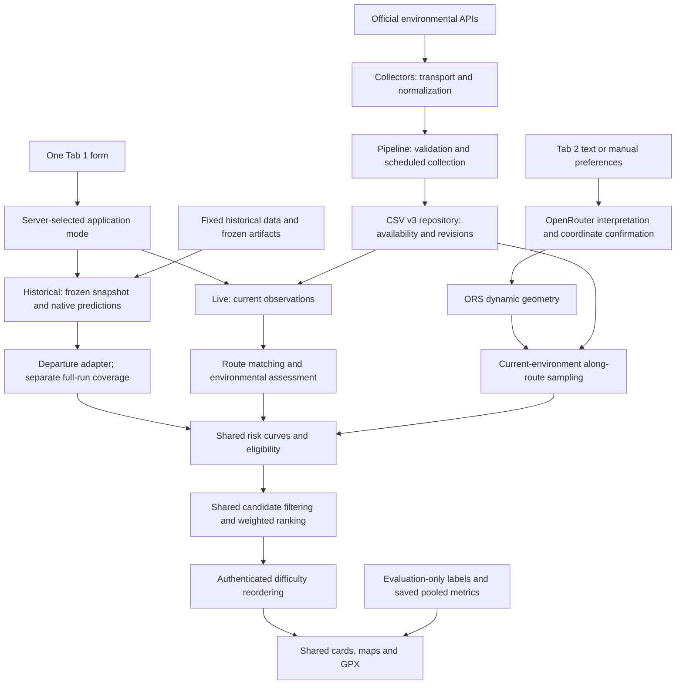

# Application architecture

OutdoorWise is one FastAPI application serving a vanilla JavaScript frontend,
plus one explicitly started environmental collector. The API and worker share
operational storage. Research and experiments remain separate from application
startup; no prediction microservice or cloud database is required.

## Execution and module boundaries

| Entry/component | Inputs → outputs and responsibility |
|---|---|
| `api/app.py:create_app` | Settings → FastAPI routers, injected repositories/services and frontend assets. Tests supply temporary data roots. |
| `bootstrap.py:build_pipeline` | TOML/settings → one environmental repository, collectors, catalog matching, risk and ranker. Construction does not collect live APIs. |
| `cli.py` | Explicit collect/watch/status/run/schemas commands; signal-aware worker shutdown. |
| `collectors/` | HTTP payloads → typed batches with canonical units; bounded retries/timeouts, no direct CSV writes. |
| `pipeline/` | Batch validation/ingestion, source cadence, worker lease/heartbeat and catalog recommendation orchestration. |
| `storage/repository.py` | Operational CSV access, source availability, revisions, locks and recoverable atomic replacement. |
| `services/route_environment.py` | One source-kind snapshot → catalog station/region metrics with timestamp and distance provenance. |
| `modules/` | Existing candidate generation, component normalization, eligibility and weighted ranking. Missing required components never become zero. |
| `accounts/`, `personalization/` | Server-side identity and isolated user history; personalization only reorders approved candidates. |
| `llm/`, `routing/` | Tab 2 language interpretation and deterministic ORS geometry/assessment. The LLM does not invent weather, geometry or tool results. |
| `prediction/` | Read-only research feature/training code, native historical inference and frozen coefficients. |
| `experiments/station_route_matching/` | Independent offline spatial comparison; no runtime imports from the application. |

## Tab 1 request flow

`frontend/app.js` obtains `/api/health.app_mode`, validates the location/preferences,
checks the session and sends one POST to `/api/route-recommendations`. `results.js`
owns shared route cards; `forecast-ranking.js` adapts replay evidence and adds
Prediction Details without a second request/submission flow. Location, difficulty,
personalization and export modules enrich the existing cards.

Live dispatch calls the existing observation pipeline once, then optional authenticated
candidate reordering. It supports Now only. Duration does not imply environmental
forecast coverage, and no supplementary persistence service is called.

Historical dispatch uses `api/forecast_ranking.py` with the fixed 2026-10-15 19:15 SGT
snapshot. It never uses the operational environmental repository as a prediction
input. PM2.5 retains its native hourly origin/horizons; no request fits models.
`api/historical_departure.py` reuses production observation assessment for Now and
accepts only exact native delayed targets with matching origin-time input provenance.
Now has numerical risk; +30/+60 retain unknown overall risk because required future
inputs are unsupported. `api/historical_evidence.py` preserves native research values,
keeps ground truth evaluation-only, and reports separate continuous-window limitations.
The [current verification](FINAL_INTEGRATION.md) records the actual availability matrix.

## Matching, risk and personalization

Catalog matching uses each route start and curated pollution regions. Dynamic routes
use samples at a target 500 m spacing, capped at 30 points, conservative component
maxima and nearest pollution-region centroids. Partial sample coverage makes the
affected risk component unavailable. Regional centroids are not polygon containment;
station distance does not establish measurement accuracy along the route. The
[independent experiment](../experiments/station_route_matching/README.md) measures
spatial matching proxies separately from production risk semantics.

The configured `EnvironmentalRiskAssessor`, `RiskPolicy` and `RiskAwareRanking` own
numeric curves, explicit blocks and weighted ordering. Complete non-blocked
assessments share weighted ranking; unknown assessments use the established
non-environmental fallback. Shared scores use generic difficulty. Authenticated
personalization only reorders survivors by difficulty mismatch, resolving ties with
shared rank; it cannot restore exclusions or overwrite scores. Historical history
and feedback are restricted to replay time. Favourites do not change ranking.

## Data and compatibility

CSV v3 stores Singapore-local second-precision timestamps without an offset suffix;
internal/HTTP values remain timezone-aware. Snapshot eligibility depends on observed,
first-fetch and optional source-update times, preserving revision provenance. Live
failures retain data with stale/missing labels rather than synthetic replacements.
Read [CSV schema](CSV_SCHEMA.md), [source semantics](API_CONFIG.md) and
[risk policy](ENVIRONMENTAL_RISK.md) for contracts.

Accounts/sessions use SQLite with scrypt hashes and HttpOnly cookies. Personalization
uses per-user atomic JSON; profiles are derived from history. Identity comes from the
server session, not arbitrary client IDs. Historical recommendations are not saved as
actual completed runs. GPX preserves geometry order and longitude/latitude conventions.

| Retained API | Reason |
|---|---|
| `/api/recommendations`, `/api/me/recommendations` | Existing observation-based clients and regression contracts |
| `/api/experimental/recommendations` | Legacy research ranking, with interval assumptions distinct from unified departure assessment |
| `/api/time-selection/forecast` | Native historical replay evidence, including older supported offsets |
| `/api/time-selection/live-forecast` | Supplementary experimental persistence compatibility; never a Tab 1 launcher |
| `/api/llm/explain` | Optional structured-candidate explanation client; the current frontend uses Tab 2 parsing |

The research inventory and evaluation files remain protected scientific evidence;
current application integration is described here and in FINAL_INTEGRATION.md.

## Deployment boundary

The image includes the package, config, frontend, catalog, frozen snapshot/artifact
and saved evaluation JSON. It excludes local runtime users/secrets and dependencies
used only by browser tests. Compose/Kubernetes share only runtime storage and retain
one API worker/replica and one collector. Scaling requires a separate durable-storage
plan for CSV, SQLite, generated routes, user JSON and sessions.

`/api/health` reports process/configuration state; `/api/ready` checks local catalog and
writable runtime storage. Neither promises fresh external observations. Collector
probes inspect heartbeat recency. See [deployment preparation](../deploy/README.md);
manifest rendering is not a running deployment.
